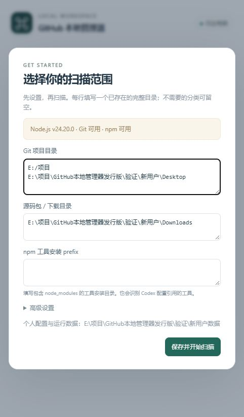

# 新手操作文档

这是给第一次使用的新手准备的说明。你可以先用浏览器面板，熟悉后再选择接入 Codex。

## 下载与打开

1. 进入仓库的 Releases，下载文件名以 `windows.zip` 结尾的运行包；GitHub 自动生成的 Source code 供开发者使用。
2. 安装 Node.js 20 或更高版本，把运行包完整解压到长期保留的文件夹。
3. 双击“启动管理器.cmd”，在打开的浏览器页面完成首次设置。
4. 填写你保存 Git 项目、下载文件和 npm 工具的目录，点击“保存并开始扫描”。留空表示不扫描相应分类目录。

上图来自隔离的新用户验证环境，目录为演示路径，不包含作者的聊天或个人配置。

## 看清单

- npm 外部工具：通过 npm 安装并带有 GitHub 来源的工具，可检查和确认后更新。
- Git 项目：具有 GitHub 远程地址的本地仓库，可检查跟踪分支并在条件满足时快进更新。
- DSH 插件和 Codex 插件：只读查看。请使用对应宿主管理安装、更新和卸载。
- GitHub 源码包：依据文件名和目录特征识别的下载包，仅供查看。

找不到项目时，先检查“设置”里的扫描目录。源码包的识别可能不准确，缓存记录也不一定代表正在运行的插件。

## 检查与更新

点击条目的检查入口，先查看当前版本、目标版本、路径和影响。确认目标正确后再执行更新；更新计划十分钟内有效。存在未提交文件、分支分叉或缺少上游时，Git 项目不会强行更新。检查 Git 更新会联网获取远程分支信息，npm 更新可能执行包自身的安装脚本。

## 在 Codex 里使用

双击“接入Codex.cmd”，按提示重新连接或重启 Codex。然后说“列出本地 GitHub 工具和项目”或“打开本地 GitHub 管理面板”。更新仍需本人明确确认。已使用本地插件接入时不要重复接入。

## 常见问题

- 双击提示找不到 Node.js：安装 Node.js LTS 后重新打开入口。
- Git 更新不可用：安装 Git for Windows，或在高级设置填写已有的 `git.exe` 路径。
- 管理面板打不开：重新运行启动入口，使用本次生成的地址。
- 接入后移动了文件夹：Codex 中原来的启动路径不会自动变化，需要按新位置重新配置。

提交问题前请遮住聊天内容、用户名、个人路径和访问地址中的凭据。不要上传个人设置、日志、配置备份或整个个人数据目录。
